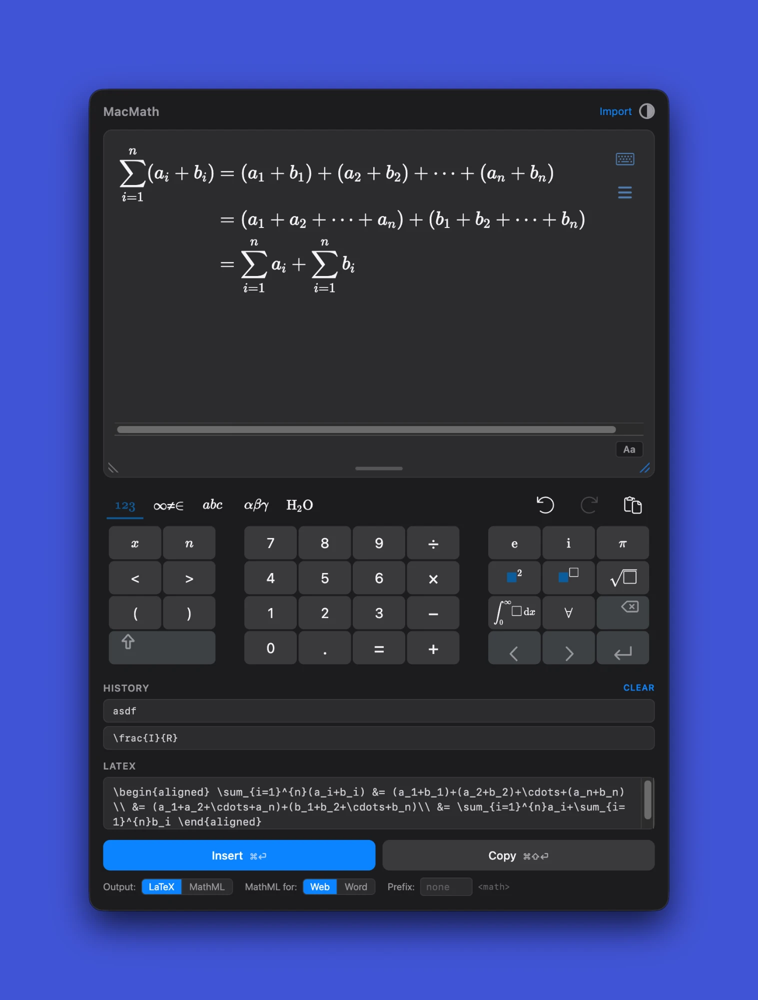

# MacMath

A macOS menu bar utility for writing math and putting it into whatever you are writing, as LaTeX or MathML.

  

  <a href="https://github.com/yblock/MacMath/releases/latest"><b>Download the latest release</b></a> 
  macOS 13 or later, Apple silicon · free and open source

## Features

- **Visual math editor** with MathLive -- type or use the virtual keyboard
- **Insert into the app you came from** -- `Cmd+Enter` pastes the expression straight into the text field you were typing in, as LaTeX or MathML; `Cmd+Shift+Enter` copies it instead
- **Edit a formula from any app** -- select it, press `Cmd+Shift+M`, and it opens in the editor; Insert then replaces the selection
- **Resizable editor** -- drag a bottom corner to make the editor wider and taller for large equations, up to the edges of your screen
- **Import** LaTeX or MathML to edit visually -- auto-detects format and namespace prefixes. Equations copied from Word paste in as math
- **Math from images** -- paste a screenshot, choose an image, or drop one on the menu bar icon, and a model on your Mac turns it into editable math: Apple Intelligence (macOS 27) or any vision model you've installed with [Ollama](https://ollama.com)
- **Chemistry** -- a chemistry keyboard (isotopes, charges, reaction and equilibrium arrows, states, elements) and mhchem's `\ce{}` and `\pu{}`, all exported to MathML that Word displays without empty boxes
- **MathML for the web or for Word** -- standard MathML for browsers and MathJax, or MathML shaped the way Word's equation import keeps it
- **MathML namespace prefix** -- set a custom prefix like `m:` or `mml:` for output
- **Expression history** -- recent expressions saved for quick re-use
- **Global shortcut** -- `Cmd+Shift+M` summons MacMath from any app, loading whatever text is selected there
- **Bold, upright and underline** -- `Cmd+B`, `Cmd+I` and `Cmd+U` toggle formatting, exported to both LaTeX and MathML
- **Light and dark mode** -- follows system preference, with a manual toggle
- **Launch at login** -- option in the tray menu
- **Text mode** -- switch between math symbols and plain text input

## Install

MacMath runs on macOS 13 (Ventura) or later.

1. Download the `.dmg` from the latest [release](https://github.com/yblock/MacMath/releases).
2. Open it and drag **MacMath** into **Applications**.
3. Open MacMath. The first time, macOS refuses because the app is not notarized: go to **System Settings → Privacy & Security**, scroll down, click **Open Anyway**, and open it again.
4. MacMath asks for the **Accessibility** permission once. Allow it; Insert and loading a selection need it (see [Permissions](#permissions)).

Its icon appears in the menu bar. Right-click it for **Launch at Login** and **Quit MacMath**.

To update, install the new `.dmg` the same way and replace the old copy; the permission stays. See [CHANGELOG.md](CHANGELOG.md) for what changed in each version.

## Usage

1. While typing in any app, press `Cmd+Shift+M` (or click the menu bar icon) to open the editor
2. Type a math expression -- it renders live
3. Press `Cmd+Enter` to insert it into the text field you came from, or `Cmd+Shift+Enter` to copy it

### Insert, Copy and the output format

**Insert** (`Cmd+Enter`) hides the editor and pastes the expression into the app that was in front before you opened MacMath, by way of the clipboard; your previous clipboard text is put back afterwards. **Copy** (`Cmd+Shift+Enter`) only puts it on the clipboard. Both produce what the **Output** toggle under the buttons says, LaTeX or MathML; MacMath remembers the choice.

If Insert reports "Copied" instead of "Inserted", MacMath could not send the paste keystroke; see [Permissions](#permissions). The expression is on the clipboard either way, so `Cmd+V` finishes the job.

### Editing a formula from another app

Select the formula in whatever app you are in, then press `Cmd+Shift+M`. The selection replaces what was in the editor (the previous expression stays in **History**). Text starting with `<` is read as MathML, anything else as LaTeX, so a selection with `$` around it keeps its dollar signs. After editing, Insert pastes over the still-selected text. Opening MacMath from the menu bar icon never reads the selection, and with nothing selected the shortcut opens the editor as always.

MacMath reads the selection through the macOS Accessibility API and, in apps that do not expose their selection that way, by sending `Cmd+C` and restoring the clipboard afterwards. Apps that draw their own text, such as Google Docs, may give nothing back.

### Permissions

Insert and loading a selection both need the **Accessibility** permission, which MacMath asks for once at first launch. If you declined, allow MacMath under **System Settings → Privacy & Security → Accessibility**. Nothing you type is stored or sent anywhere; the permission is used only to paste and to read the selected text.

### Import

To import an existing expression, click **Import** and paste LaTeX or MathML. The format is detected automatically, including namespace-prefixed MathML like `<m:math>`.

An equation copied in Word pastes in as math, in the editor or the **Import** box: MacMath reads the equation Word puts on the clipboard, not its plain text ("v=ma", which loses bold, fractions and the like). Several equations become the rows of one `gathered`; text copied along with them is left out.

### MathML for the web or for Word

Under the buttons, **MathML for** picks where the MathML is going. MacMath remembers the choice.

- **Web** (the default) writes standard MathML for browsers, MathJax and XML files. Spaces such as `\,` and `\quad` are `<mspace>` elements.
- **Word** writes MathML that Word's equation import keeps. Word drops `<mspace>`, so spaces become space characters (a thin space for `\,`, an em space for `\quad`; a negative space like `\!` is left out). Function names such as sin, log and lim come out upright with their space after them, `\overline` and `\underline` become bars, braces stretch over their contents, and `\mathsf` and `\mathtt` keep their fonts. Isotopes get an invisible filler instead of an empty slot, which Word shows as a box.

Importing reads either kind back.

### Chemistry

Open the virtual keyboard and choose **H₂O** for chemistry keys: isotopes (mass and atomic number on the left), upright element symbols, atom counts, charges, the hydrate dot, reaction, equilibrium and resonance arrows (also with conditions above and below), gas and precipitate arrows, states like (aq), and common constants. Hold a key for related ones, such as other elements or Ksp. Press `Tab` to move to the next box in a key's template.

MacMath also understands [mhchem](https://mhchem.github.io/MathJax-mhchem/): `\ce{2H2 + O2 -> 2H2O}` or `\pu{123 kJ/mol}`. Paste it into the editor or load it with **Import**. Typing `\ce{…}` straight into the editor works only without spaces (`\ce{H2O}`), because a space ends a typed command. LaTeX output keeps `\ce{}`; MathML output writes the formula out in full.

Isotopes like ³He are copied as MathML prescripts (`<mmultiscripts>`). For Word, the missing prescript is an invisible copy of the other, because Word draws an empty slot as a box.

### Reading math from images

MacMath can turn an image of math into an expression you can edit. The image is read on your Mac and never uploaded. Any of these works:

- Copy a screenshot (`Cmd+Ctrl+Shift+4`) or an image file in Finder, open MacMath and press `Cmd+V`
- Click **Import**, then **Image…**, and choose a file
- Drag an image file onto the MacMath icon in the menu bar

A spinner covers the editor while the image is read, which takes a few seconds (longer the first time, while the model loads). The result replaces what's in the editor. Before the model sees the image, MacMath crops it to the math, enlarges small formulas and fills a transparent background with white. Any image format macOS opens works, including HEIC, TIFF and WebP. MacMath tidies the LaTeX the model writes, for example `pmatrix` instead of `\left(\begin{array}…\right)`. Models write every word as upright text, so MacMath measures the slant of each word in the image and keeps italic words italic (`\mathit{unc}` in *% unc r*). Check the result before inserting: models can misread symbols, especially in handwriting.

Choose the model under **Import** → **Read images with**:

- **Apple Intelligence** needs macOS 27 or later on an Apple silicon Mac with Apple Intelligence turned on.
- **Ollama** works on any Mac that runs [Ollama](https://ollama.com), a free app for local AI models. If nothing on your Mac can read images yet, **Import** offers the next step: **Get Ollama…** opens its download page, **Start Ollama** opens the app, and **Download** fetches the recommended model: `qwen2.5vl:7b` (6 GB) when your Mac has the memory for it, otherwise `qwen2.5vl:3b` (3.2 GB). The 7B model is more accurate, especially with words and matrices, and takes about 10 seconds an image. Any other Ollama model that reads images also appears in the list. Models too large for your Mac's memory are listed but can't be chosen, because loading one can freeze the Mac. MacMath has Ollama unload the model 30 seconds after the last image, and when MacMath quits, so it doesn't hold on to memory.
- **Automatic** (the default) uses Apple Intelligence when it's available, otherwise the recommended Ollama model, otherwise another installed Ollama model that reads images.

### Resizing

Need more room? Drag either bottom corner of the editor to resize it in both directions, or the handle at the bottom center to change only its height. MacMath never grows past the edges of your screen; if the virtual keyboard needs the space, the editor shrinks to fit. Double-click a handle to go back to the default size. Each time you reopen MacMath it starts at the default size again, with your expression still there.

## Keyboard Shortcuts

| Shortcut | Action |
|---|---|
| `Cmd+Shift+M` | Open MacMath from any app, loading the text selected there; hide it again |
| `Cmd+Enter` | Insert into the app you came from (LaTeX or MathML, per the Output toggle) |
| `Cmd+Shift+Enter` | Copy to the clipboard |
| `Cmd+B` | Toggle bold |
| `Cmd+I` | Toggle upright letters in math (`\mathrm`, such as the label in Fv); italic in text |
| `Cmd+U` | Toggle underline on the selection |
| `Cmd+Z` | Undo |
| `Cmd+Shift+Z` | Redo |

## Troubleshooting

### macOS says MacMath cannot be opened

The app is not notarized. Go to **System Settings → Privacy & Security**, scroll down to the message about MacMath, click **Open Anyway**, and open it again. This is needed once per install.

### Insert only copies, or `Cmd+Shift+M` ignores the selected text

Both need the Accessibility permission; see [Permissions](#permissions). If MacMath is listed there and switched on but it still does not work, remove MacMath from the list, add it again, then quit and reopen it.

### Reading an image says Ollama isn't running, or takes very long

Open the Ollama app; MacMath needs it running in the background. The first image after a while takes longer because Ollama loads the model into memory. If your Mac slows down badly, choose a smaller model under **Import** → **Read images with**, or quit apps you aren't using.

## License

MIT

## For contributors

Bug reports and ideas go to the [issue tracker](https://github.com/yblock/MacMath/issues). To run MacMath from source, build it, run the tests or make a release, see [DEVELOPING.md](DEVELOPING.md); it also explains why builds are signed and how the Insert and selection features reach other apps.
